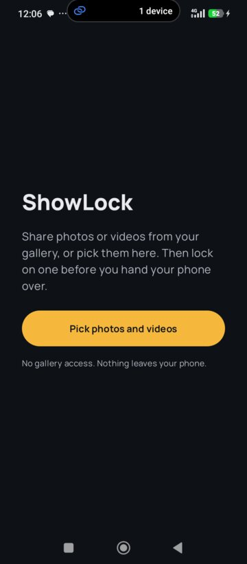
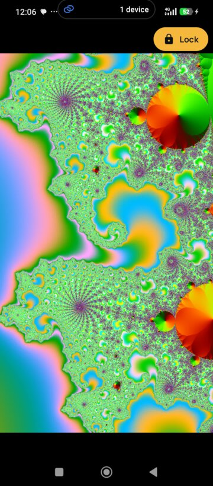
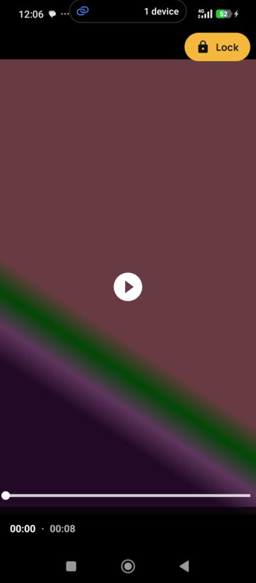

# ShowLock

Hand someone your phone to show a photo, and they can't swipe to the next one.

ShowLock is a small Android viewer that shows only the photos and videos you chose. Lock it on one, and only your fingerprint or screen lock gets you out.

<p>
  
  
  
  
</p>

## Why

You want to show someone one picture. They swipe, and now they're looking at the rest of your gallery. Android's screen pinning doesn't help: inside a pinned gallery app, swiping still works.

ShowLock only ever holds the items you hand it, and it can freeze on one of them.

## What it does

- **Receives photos and videos** from the share sheet (one or many), from "Open with", or from the system Photo Picker.
- **Full-screen viewer:** swipe between the items you chose, pinch or double-tap to zoom, pan, and play videos with play/pause and a seek bar.
- **Lock** freezes the viewer on the current item. Swiping is off, Back does nothing, and new shares are ignored. You can still zoom.
- **Unlock** with your fingerprint, or fall back to your PIN, pattern or password.
- **Screen pinning** starts with the first lock and lasts until you leave the viewer, so Home and Recents stay blocked. Unlocking just lets you swipe again, and you can lock on another item without a new prompt.
- The lock survives rotation, screen-off and the app being recreated.

## Privacy

- **Never reads your gallery.** It only sees the items you explicitly share or pick, through Android's temporary read grants. It has no storage permission.
- **Never copies anything.** Photos aren't saved, cached to app storage or backed up. Nothing is remembered between sessions.
- **No internet permission.** No analytics, ads or crash reporting.

Manifest permissions, in full:

| Permission | Why |
|---|---|
| `USE_BIOMETRIC` | Unlocking with your fingerprint or screen lock. |
| `io.github.iamrehman16.showlock.DYNAMIC_RECEIVER_NOT_EXPORTED_PERMISSION` | Added by AndroidX. A signature-level permission the app defines for itself, so only ShowLock can reach its own internal receivers. Gives no access to anything. |

## Install

Requires **Android 11 (API 30)** or newer, with a screen lock set.

1. Download `ShowLock-<version>-debug.apk` from [Releases](https://github.com/iamrehman16/showlock/releases).
2. Open it on your phone and allow installing from that source when asked.

For full protection, turn on **App pinning** in *Settings > Security*, and also **Ask for PIN before unpinning**. Without pinning, the in-app lock still holds the photo, but Home and Recents work. Without "Ask for PIN", a guest can exit pinning with the system gesture.

## How to use

1. In your gallery, select photos or videos, tap **Share**, and choose **ShowLock**. You can also open ShowLock and tap **Pick photos and videos**.
2. Swipe to the one you want to show and tap **Lock**. The first time, Android asks to pin the app; confirm.
3. Hand over the phone.
4. To unlock, tap the small lock icon in the top corner and use your fingerprint or PIN.
5. When you're done, press Back while unlocked. Pinning ends and ShowLock closes.

## Build from source

No Android Studio needed.

- JDK 17 or newer
- Android SDK with platform 37 and build-tools 37 (`ANDROID_HOME` set)

```sh
./gradlew assembleDebug   # app/build/outputs/apk/debug/app-debug.apk
./gradlew lint
./gradlew installDebug    # to a phone with USB debugging on
```

Kotlin, Jetpack Compose (Material 3), Coil for images, Media3 ExoPlayer for video, and AndroidX Biometric. The whole app is a handful of files in `app/src/main/java/io/github/iamrehman16/showlock/`. [`mvp.md`](mvp.md) is the spec it was built from.

## License

[GPL-3.0](LICENSE). The bundled Manrope font is under the [SIL Open Font License 1.1](third_party/manrope/OFL.txt).
